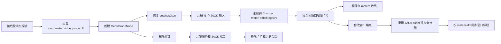
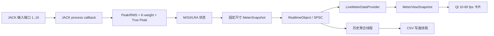

# WinJACKNexus - 电平表桥 - 开发计划

> 版本：v1.14
> 日期：2026-09-12
> 依据：《WinJACKNexus 开发规范》v3.1、《WinJACKNexus - 接线盘 - 开发计划》、ITU-R BS.1770-5、EBU R 128、EBU Tech 3341、EBU Tech 3342、《LUFS参考表》
> 模块分类：**Meter / 电平表**
> 交付状态：UI 阶段（UI-1～UI-5）已完成（2026-09-12），UI-5 设计冻结待用户人工验收；按用户明确授权，LOGIC-1 Common 计量核心、LOGIC-2 五种 JACK 输入探针、LOGIC-3 真实快照数据链和 LOGIC-4 应用集成已完成（2026-09-12）。正式 Bridge 直接消费 Probe 的实时 `MeterSnapshot`，并在可见时以 10 Hz 刷新卡片与历史；LOGIC-4 已覆盖唯一 Bridge 服务入口、四项全局设置、自动重置/CSV 会话轮换、工程 `meters[]`、窗口与卡片顺序恢复。LOGIC-5 尚未开始；真实 JACK/UI 路由由用户人工验收。

---

## 0. 计划要点（用户需求摘要）

| 需求 | 方案结论 |
| :--- | :--- |
| 探针节点 | `mod_meterbridge_probe.dll` 导出 **单声道、立体声、5.1、7.1、自定义** 5 种仅输入节点 |
| 客户端名称 | 每个探针支持修改 JACK 客户端名；改名成功后接线盘、电平表桥卡片、历史窗口和相关入口同步更新 |
| 自定义声道 | 支持 **1～16 声道**；侧边栏可设置声道数量、逐通道名称/角色和 LFE 标记 |
| LFE | 可多选；LFE 端口仍接收并在历史图显示独立 LFE 曲线，但权重固定为 0，**不参与卡片总体 Peak、RMS、dBTP、M、S、I、LRA 计算** |
| 窗口模型 | 电平表桥是一个独立集合窗口；“电平表桥”和“历史图表”位于同一窗口的标签页；每添加 1 个探针节点，桥页自动增加 1 张卡片；删除节点时移除对应卡片 |
| 卡片值 | 每张卡片显示该探针全部非 LFE 输入经多声道公式计算后的综合值，不把各声道误当成多张卡片 |
| 快捷入口 | 快捷栏增加固定“电平表桥”按钮，并恢复托盘 `meterbridgeAction()`；按钮打开/聚焦唯一桥窗口 |
| 响度标准 | K 加权、通道位置权重、400 ms/75% 门控、绝对/相对双门限、LRA 和 True Peak 按 ITU-R BS.1770-5 / EBU Tech 3341/3342 实现 |
| 卡片交互 | 卡片右键菜单含“打开历史图表”和“自动重置响度”；自动重置默认勾选 |
| 术语显示 | 用户界面中的已翻译响度术语统一采用“中文（原英文）”格式，例如峰值（Peak）、均方根（RMS）、瞬时（Momentary）、短时（Short-term）、综合（Integrated） |
| 历史布局 | 参照需求图：左侧显示设置，中部含 LFE 的多曲线历史图，下方当前视图统计 |
| 图表刷新模式 | 保留滚动模式并设为默认；另提供类似心电图的扫描模式，画布不滚动，扫描线经过的位置逐点覆盖更新 |
| 预设 | 覆盖《LUFS参考表》中的音乐、视频/社交、广电、游戏全部条目；预设只改变目标线/峰值线和显示名称，不改变标准测量算法 |
| 全局设置 | 增加默认响度标准、静音阈值、静音时长和日志保存根目录；新建探针继承默认值，已有探针可选择跟随全局或保持覆盖值 |
| 日志文件 | CSV 按“日志根目录/客户端名字/开始时间戳.csv”保存；每次手动或自动重置后关闭当前文件并另起文件记录 |
| 实时约束 | JACK 回调无锁、无分配、无 Qt；DSP 状态通过固定容量 SPSC/三缓冲快照发布给 GUI |
| 开发阶段 | 分为“UI 设计”和“逻辑与节点实现”两个大阶段；UI 阶段全程使用模拟数据，第二阶段直接接入节点产生的真实数据 |
| UI 归属 | 可复用控件和所有自绘控件归入 `WinJACKNexus::UI`；Meterbridge 模块只保留业务窗口组合、数据适配和节点逻辑 |

---

## 1. 目标、范围与非目标

### 1.1 目标

1. 在接线盘中提供五种可重复添加的监听探针节点，监听任意 JACK 音频信号但不输出、不改变、不旁通音频。
3. 为 1～16 声道输入提供符合广播标准的综合 Peak、RMS、True Peak、Momentary、Short-term、Integrated 和 LRA。
4. 提供可操作的实时卡片、历史曲线、统计、CSV 记录与图表导出能力。
5. 将探针配置、响度状态和窗口布局纳入 `.wjnproj`，将用户默认值纳入全局设置。

### 1.2 非目标

- 探针没有 JACK 输出端口，不提供增益、限幅、归一化或任何音频处理。
- 不把平台目标值写入 DSP 公式；Spotify、Netflix 等预设只是参考线和合规提示。
- 不把 LFE 的 `+10 dB` 回放增益补偿用于 EBU Mode。只要 LFE 被计入响度，就不再符合 ITU-R BS.1770 / EBU Mode；本模块始终排除已标记 LFE。
- 第一阶段不实现对象音频渲染；对象音频须先按 ITU-R BS.1770-5 Annex 4 渲染为扬声器通道，再输入探针。
- 不在本计划中改造现有通用 `MeterWidget` 的旧 Peak 显示语义；广播测量核心使用独立、可测试的 Meter Core。

---

## 2. 现状与集成边界

### 2.1 已有能力

| 现有组件 | 可复用能力 | 本计划增量 |
| :--- | :--- | :--- |
| `WinJACKNexus::Node` API v2 | 一个 DLL 导出多个节点定义；节点设置 JSON；设置侧边栏；独立 GUI 导出 | `mod_meterbridge_probe.dll` 导出 5 种探针定义 |
| WinJACKNexus 主模块加载器 | 从主程序同级目录加载顶层模块 DLL | 同级 `mod_meterbrigde.dll` 承载唯一桥窗口、服务和 UI 模拟数据路径 |
| Patchbay `scanNodeModules()` | 递归扫描 `nodes/**/*.dll`，按 DLL 分类和节点索引创建实例 | `nodes/meter/mod_meterbridge_probe.dll` 自动进入“Meter”分类 |
| `LoadedModuleNode` | 创建节点、恢复设置、持有实例、发布可打开 GUI 的条目 | 对 Meter 实例发布统一桥窗口入口，而非每实例创建不同顶层窗口 |
| `TrayController` / `QuickAccessBar` | 接线盘按钮、动态节点 GUI 菜单 | 实现 `meterbridgeAction()`，增加固定“电平表桥”按钮和聚合窗口回调 |
| `GlobalSettingsDialog` | `QSettings` 即时持久化 | 增加 `Meterbridge` 设置组和 3 个全局字段 |
| `JackClient` / `JackPort` | JACK 客户端、1～16 端口注册和回调 | 每个探针注册 N 个 `JackPortIsInput` 音频端口 |
| `RealtimeObject` / `LockFreeSpscQueue` | 实时线程到 UI 的无锁数据发布 | 发布固定尺寸 `MeterFrame`、事件和历史采样 |
| `MeterWidget` / `AnimatedWidget` | 基础自绘电平动画和隐藏暂停刷新 | 复用绘制基础设施；广播算法、刻度和数值由 Meterbridge 自己提供 |

### 2.2 必须补齐的入口

主程序直接加载 `mod_patchbay.dll` 和同级 `mod_meterbrigde.dll`；普通探针节点由接线盘扫描 `nodes/**/*.dll` 并持有。电平表桥是跨多个探针实例的唯一集合窗口，因此不能简单地把任意一张探针卡片当作全局入口。

实施时采用以下契约：

1. 同级 `mod_meterbrigde.dll` 内部提供进程内单例 `MeterbridgeService`，注册/注销所有 `MeterProbeNode` 实例并拥有唯一 `MeterbridgeWindow`。
2. `nodes/meter/mod_meterbridge_probe.dll` 只导出五种探针节点；任一探针的 `wjn_show_node_gui()` 通过主模块公开的进程内服务接口打开桥窗口并选中自己的卡片。
3. Patchbay 检测到 `category == "Meter"` 的实例后，只发布一个稳定 ID 为 `tool:meterbridge` 的聚合 `TrayNodeGuiEntry`，避免快捷栏按实例重复生成按钮。
4. `TrayController::meterbridgeAction()` 返回真实占位动作；`QuickAccessBar` 增加固定“电平表桥”按钮，动作在首个 Meter 模块成功加载后启用。
5. 没有探针时允许打开空状态桥窗口，并提供“前往接线盘添加探针”的命令；桥窗口本身不创建隐藏 JACK 客户端。

---

## 3. 交付物与目录结构

### 3.1 交付物

| 产物 | 部署位置 | 说明 |
| :--- | :--- | :--- |
| `mod_meterbrigde.dll` | 主程序同级目录 | 顶层桥模块：唯一桥窗口、服务、数据适配和业务 UI |
| `mod_meterbridge_probe.dll` | `nodes/meter/` | 5 种探针节点、JACK 输入、实例注册和节点设置面板 |
| `WinJACKNexus::Common` 计量核心 | `common.dll` / `src/common/` | 无 Qt/JACK 源码依赖的声道布局、K 加权、Peak/True Peak、M/S/I/LRA、快照和静音重置状态机 |
| 通用 Meter UI 控件 | `WinJACKNexus::UI` | 综合电平柱、指标读数、历史曲线、图例、统计条等可复用/自绘控件 |
| Meterbridge 业务 UI | 编译进 `mod_meterbrigde.dll` | 桥窗口、卡片组合、历史窗口编排、设置与命令绑定 |
| UI 模拟数据模式 | `mod_meterbrigde.dll` 的开发期路径 | 使用确定性模拟数据验收卡片、历史图和各视觉状态；不产生独立 EXE |
| 全局设置增量 | `WinJACKNexus.exe` | 默认标准、静音阈值、静音时长 |
| 快捷栏增量 | `ui.dll` + 主程序/接线盘注册路径 | 固定电平表桥入口 |
| 测试 | `tests/meter/` | 官方向量、合成多声道、静音重置、节点 ABI、存档和 UI 模型测试 |

### 3.2 规划目录

```text
src/common/
├─ CMakeLists.txt
├─ include/WinJACKNexus/Common/
│  ├─ ChannelLayout.hpp
│  ├─ LoudnessEngine.hpp
│  ├─ MeterSnapshot.hpp
│  └─ SilenceResetController.hpp
└─ src/
  └─ LoudnessEngine.cpp
src/meter/
├─ CMakeLists.txt
├─ ui/
│  ├─ include/WinJACKNexus/Meter/
│  │  ├─ MeterViewSnapshot.hpp
│  │  ├─ MeterViewDataProvider.hpp
│  │  └─ MockMeterDataProvider.hpp
│  └─ src/
│     └─ MockMeterDataProvider.cpp
├─ mod/
│  ├─ include/WinJACKNexus/Meter/Mod/
│  │  ├─ MeterbridgeService.hpp
│  │  ├─ MeterbridgeWindow.hpp
│  │  ├─ MeterCard.hpp
│  │  ├─ MeterHistoryWindow.hpp
│  │  └─ MeterSettingsWidget.hpp
│  ├─ src/
│  │  ├─ Library.cpp
│  │  ├─ MeterbridgeService.cpp
│  │  ├─ MeterbridgeWindow.cpp
│  │  ├─ MeterCard.cpp
│  │  ├─ MeterHistoryWindow.cpp
│  │  └─ MeterSettingsWidget.cpp
│  └─ resources/
│     └─ meterbridge.qrc
└─ probe/
  ├─ include/WinJACKNexus/Meter/Probe/
  │  ├─ MeterProbeNode.hpp
  │  └─ MeterProbeSettingsWidget.hpp
  └─ src/
    ├─ Library.cpp
    ├─ MeterProbeNode.cpp
    └─ MeterProbeSettingsWidget.cpp
tests/meter/
├─ PresetTests.cpp
└─ MeterNodeContractTests.cpp
tests/common/
└─ CommonTests.cpp
```

样式仍由全局唯一 `style.css` / `ThemePalette` 提供；Meterbridge 不另建私有主题体系，不在 C++ 中硬编码最终颜色。

`MeterLevelBar`、`HistoryChartWidget` 等自绘控件不得依赖 JACK、Meter Core 或节点 ABI，只接收 UI 层值对象和基础类型。`MeterCard`、`MeterHistoryWindow` 等包含 Meterbridge 业务语义的组合界面保留在 Meterbridge 模块，通过适配器把领域快照转换为 UI 控件属性，避免 `WinJACKNexus::UI` 反向依赖功能模块。

### 3.3 两阶段边界

开发严格分为两个大阶段：

1. **阶段一：UI 设计。** 先冻结 UI 所需的只读 `MeterViewSnapshot` 契约，再用 `MockMeterDataProvider` 产生静音、正常节目、超限、离线、重置、1～16 声道及长历史等确定性场景。此阶段不创建 JACK client、不加载响度后端，也不以临时 DSP 结果驱动界面。
2. **阶段二：逻辑与节点实现。** 实现 Meter Core 和五种节点后，由 `LiveMeterDataProvider` 直接读取节点发布的真实 `MeterSnapshot` 并映射到同一 `MeterViewSnapshot`。正式构建不启用随机模拟器，不保留“先模拟再转发”的生产数据链。

两个阶段只通过稳定快照契约衔接。UI 阶段冻结的是展示字段、状态语义和命令接口，不冻结尚未验证的 DSP 内部结构。

---

## 4. 探针节点设计

### 4.1 DLL 导出的五种节点

| 索引 | 节点名 | 输入端口 | 默认声道角色 | 默认 LFE |
| :---: | :--- | :---: | :--- | :--- |
| 0 | Meter Probe Mono | 1 | `M+000` / Mono | 无 |
| 1 | Meter Probe Stereo | 2 | `M+030, M-030` / L, R | 无 |
| 2 | Meter Probe 5.1 | 6 | L, R, C, LFE, Ls, Rs | 第 4 路 |
| 3 | Meter Probe 7.1 | 8 | L, R, C, LFE, Ls, Rs, Lb, Rb | 第 4 路 |
| 4 | Meter Probe Custom | 1～16 | 初始为 L, R, C, LFE, Ls, Rs，超出部分按 `M±135/M±180` 等可编辑角色补齐 | 用户可多选 |

所有端口均为 `JACK_DEFAULT_AUDIO_TYPE | JackPortIsInput`。端口真实名直接使用声道名：Mono 为 `M`，Stereo 为 `L`、`R`，5.1/7.1 使用表中的 `L/R/C/LFE/Ls/Rs/Lb/Rb`；Custom 使用用户设置的逐通道名称。名称必须是合法且唯一的 JACK 短端口名；改名通过事务式重建按通道映射恢复已有连接，不保留 `in_1`～`in_16` 形式的隐藏真实名或仅显示别名。

### 4.2 自定义探针侧边栏

自定义节点被选中时，右侧设置面板提供：

| 控件 | 行为 |
| :--- | :--- |
| 客户端名称 | 修改探针的 JACK 客户端名；成功后同步更新接线盘节点、电平表桥卡片、历史窗口标题和 GUI 条目；重名沿用 JACK/现有自增规则并显示最终实际名称 |
| 声道数量 | `QSpinBox`，范围 1～16；增减后重建端口并按现有机制恢复未变化端口的连接 |
| 声道表格 | 每行包含端口序号、显示名称、扬声器角色/位置、LFE 复选框 |
| 声道角色 | 选择 BS.1770-5/BS.2051 角色，如 `M+030`、`M-030`、`M+000`、`M±090`、`M±110`、`M±135`、`M+180` 及上层/下层位置 |
| LFE | 每行独立复选框，允许勾选多个；勾选后角色显示为 LFE，综合计算权重强制为 0 |
| 跟随全局默认标准 | 默认开启；关闭后允许该探针单独选择响度预设 |

Mono、Stereo、5.1、7.1 固定布局节点也显示只读声道表，并与 Custom 一样允许修改 JACK 客户端名称、响度预设和自动重置开关；固定布局不允许改变声道数量和标准角色。

### 4.3 客户端改名与界面同步

现有 `JackClient` 封装没有运行时 rename API，因此探针改名采用可回滚的事务式重建，不把仅修改 Qt 标题误认为 JACK 客户端已改名：

1. 校验并规范化用户输入；空名称拒绝应用，过长或 JACK 非法字符按统一客户端命名规则处理。
2. 以稳定 `instanceId` 记录探针身份，并快照当前客户端实际名称、端口、连接、DSP 配置和测量状态。
3. 停用并关闭旧 JACK client，以请求名称重新打开同一探针实例，重新注册同名端口并恢复连接。
4. 重开成功后读取 JACK 返回的**实际客户端名**。若发生重名自增，以实际名称为唯一显示来源。
5. `Common::MeterProbeRegistry` 更新带 `instanceId`、实际名称和递增 `nameRevision` 的注册项；Bridge 卡片和历史窗口在下一次实时刷新时同步标题。接线盘、快捷栏/托盘 GUI 入口将在应用集成阶段复用同一稳定身份更新。
6. 改名不新增或删除卡片，不改变卡片顺序、历史数据、累计响度、预设和自动重置配置。
7. 任一步骤失败时尝试按旧名称重开并恢复原连接；界面保持旧的已确认名称并显示错误，不发布半完成状态。

工程保存使用稳定 `instanceId` 关联探针，`clientName` 保存最后一次成功改名后的 JACK 实际名称。加载工程时若 JACK 因冲突分配了不同名称，应立即把实际名称同步回窗口和内存模型，并在下次保存时写入新值。

### 4.4 生命周期



节点初始化和窗口是否可见互不依赖。桥窗口隐藏时暂停 UI 定时器和重绘，但 JACK 计量、自动重置判断以及启用的 CSV 记录继续运行。

---

## 5. 广播标准计算核心

### 5.1 实现策略

LOGIC-1 在 `WinJACKNexus::Common` 中实现 `LoudnessEngine`，不创建独立 `meterbridge_core`。核心源代码不依赖 Qt、JACK、Meter UI 或节点 ABI；`prepare()` 固化 1～16 声道布局和采样率，`process()` 使用固定容量滤波、窗口和直方图状态，不进行锁操作或动态内存分配。

当前实现覆盖 K 加权、声道位置权重、LFE 排除、400 ms / 75% 重叠的 Integrated 双门限、3 s / 10 Hz LRA、Sample Peak、4×/2×/1×采样率分支的 True Peak 估算、RMS、无效浮点隔离和静音重置状态机。`MeterSnapshot` 是后续节点和 UI 之间的纯值对象边界。

Common 测试目前使用 BS.1770 48 kHz 系数向量和可复现合成音频向量覆盖算法路径。外部 ITU/EBU 音频文件尚未纳入仓库；在 LOGIC-3 真实数据接入前，应将可追溯的官方音频向量加入测试，再进行最终容差复核，不改变公共 `LoudnessEngine` 接口。

### 5.2 K 加权与多声道响度

每个非 LFE 通道先通过 BS.1770 两级 K 加权滤波器。对测量窗口内第 $i$ 个通道的均方能量 $z_i$，综合响度为：

$$
L_K = -0.691 + 10\log_{10}\left(\sum_{i=1}^{N} G_i z_i\right)\ \mathrm{LUFS}
$$

其中：

- $G_i$ 是声道位置权重；L/R/C/前方/后方通常为 $1.00$；水平面侧向 $60^\circ\leq|\theta|\leq120^\circ$ 且 $|\phi|<30^\circ$ 时为 $1.41$（约 $+1.5$ dB）；其他 Annex 3 位置为 $1.00$。
- 5.1 的 Ls/Rs 使用 $1.41$；L/R/C 使用 $1.00$。
- 7.1 预置按 `0+7+0` 角色表设置：侧向通道使用 $1.41$，后方通道使用 $1.00$。
- 任意标记为 LFE 的通道 $G_i=0$，不进入 $N$ 和能量和式。
- Mono 按单声道节目测量，不默认使用 `DUAL_MONO` 加倍；仅未来显式的 Dual Mono 布局才可加倍。

### 5.3 Momentary、Short-term、Integrated

| 指标 | 标准窗口/门限 | 刷新 |
| :--- | :--- | :--- |
| Momentary (M) | 最近 400 ms 矩形滑窗，不门控 | UI/DSP 至少 10 Hz |
| Short-term (S) | 最近 3 s 矩形滑窗，不门控 | 至少 10 Hz |
| Integrated (I) | 400 ms 分块，块间 75% 重叠，即每 100 ms 产生一块 | 至少 1 Hz，可内部 10 Hz 更新 |

Integrated 使用级联门控：

1. 丢弃低于 $-70$ LUFS 的 400 ms 块。
2. 对通过绝对门的块在能量域求平均，得到绝对门控响度 $L_{abs}$。
3. 相对门限为 $L_{rel}=L_{abs}-10$ LU。
4. 对同时通过绝对门和相对门的块在能量域重新求平均，得到 Integrated LUFS。
5. 测量结束时不足 400 ms 的尾块丢弃；实时状态显示为无有效值时使用 `--`，不伪造为 `-70 LUFS`。

### 5.4 Loudness Range（LRA）

LRA 按 EBU Tech 3342：

1. 生成 3 s Short-term 滑窗值，相邻窗口至少重叠 2.9 s，即采样率不低于 10 Hz。
2. 先应用 $-70$ LUFS 绝对门。
3. 对绝对门后的值在能量域求平均；相对门为该值下方 $20$ LU。
4. 对通过两级门限的分布取第 10 百分位 $P_{10}$ 和第 95 百分位 $P_{95}$。

$$
LRA=P_{95}-P_{10}\ \mathrm{LU}
$$

LRA 与 Integrated 使用同一测量会话；手动或自动重置 Integrated 时必须同步清空 LRA。

### 5.5 Peak、RMS 与 True Peak 综合值

卡片只展示一个多声道综合值，但核心保留逐通道值供诊断和测试。

| 指标 | 每张卡片的综合定义 |
| :--- | :--- |
| Peak (dBFS) | 当前刷新块所有**非 LFE**声道样本绝对值的最大值：$20\log_{10}(\max_{i,n}|x_i[n]|)$ |
| RMS (dBFS) | 当前 400 ms 窗口全部**非 LFE**声道按 BS.1770 位置权重合并后的能量均方根；换算 $20\log_{10}(RMS)$ |
| dBTP | 各非 LFE 声道 True Peak 的最大值；48 kHz 至少 4× 上采样到 192 kHz，96 kHz 至少 2×，192 kHz 可不再上采样 |

True Peak 对每声道执行多相 FIR 插值，取连续时间重构近似的最大绝对值，再取非 LFE 声道最大值：

$$
TP=20\log_{10}\left(\max_i\max_m|\hat{x}_i[m]|\right)\ \mathrm{dBTP}
$$

卡片 Peak 和 dBTP 的“总体”定义均是最大非 LFE 声道，而不是先将各声道求和。这样不会因互不相关或反相信号相加而漏报过载，也与多声道传输链按任一通道峰值限额的实践一致。

### 5.6 参考标准与版本锁定

| 文档 | 本计划采用内容 |
| :--- | :--- |
| ITU-R BS.1770-5（2023-11） | K 加权、多声道能量和、LFE 排除、400 ms/75% 门控、Annex 2 True Peak、Annex 3 位置权重 |
| EBU R 128 | EBU Programme Loudness / LRA / Maximum True Peak 使用语义 |
| EBU Tech 3341 v5（2023） | EBU Mode 的 M=0.4 s、S=3 s、I 门控、刷新率和显示要求 |
| EBU Tech 3342 v4（2023） | LRA 的 3 s/10 Hz、$-70$ LUFS、相对 $-20$ LU、10/95 百分位 |

实现注释和测试数据记录规范版本；后续规范升级不得静默改变旧工程结果，需递增算法版本并提供迁移说明。

---

## 6. 自动重置响度

### 6.1 配置

| 配置 | 默认值 | 范围/说明 |
| :--- | :--- | :--- |
| 自动重置响度 | 开启 | 每卡片可在右键菜单切换并持久化 |
| 静音阈值 | `-70.0 dBFS` | 全局默认；建议范围 `-120.0～-20.0 dBFS` |
| 静音时长 | `3.0 s` | 全局默认；建议范围 `0.1～60.0 s` |

### 6.2 判定状态机

静音判定使用非 LFE 声道的综合 Sample Peak，而不是门控后的 LUFS：

1. 任一非 LFE 声道 Peak 高于静音阈值时，状态为 `Active` 并清零静音计时。
2. 所有非 LFE 声道 Peak 持续不高于阈值时进入 `PendingSilence`。
3. 连续静音达到设定时长后，仅触发一次 `ResetPending`。
4. 在下一次信号重新高于阈值时执行响度会话重置，再开始新节目；持续静音期间不每帧反复重置。
5. 自动重置清空 Integrated、LRA、M/S 最大值、累计 Peak/dBTP 和当前历史会话；卡片瞬时 Peak/RMS 可继续显示底噪。
6. 手动“重置响度”立即执行相同原子重置，不等待信号恢复。
7. 若已启用 CSV 记录，手动或自动重置同时结束当前日志会话；下一测量会话使用新的开始时间戳创建新 CSV，不向重置前文件追加数据。

若所有通道都被标记为 LFE，设置面板阻止应用并提示“至少保留一个参与总体计算的非 LFE 声道”。

---

## 7. 电平表桥卡片 UI

### 7.1 集合窗口

- 唯一、可缩放的独立顶层窗口，标题“电平表桥”。
- 卡片按添加顺序排列；窗口宽度不足时横向滚动，不把窄卡压缩到数值溢出。
- 每张卡保持固定窄宽度；高度跟随桥页可用视口并设最小值，增加/删除、数值位数变化、峰值动画均不得改变其他卡片的宽度或造成内容重叠。
- 节点被删除时卡片移除；节点暂时离线时卡片保留并标明离线，不显示陈旧值为实时值。
- 单击卡片选中对应接线盘节点；从接线盘打开节点 GUI 时打开桥窗口并滚动到该卡片。

### 7.2 单卡片布局（参考需求图）

从上到下：

1. 节点编号、名称和布局标签，如 `Mic 1 (Mono)`、`Program 5.1`。
2. 响度标准下拉框，显示当前预设，如 `EBU R128`。
3. 左侧综合竖直电平柱：`-72～+12 dB`，带刻度、Peak Hold 和分段阈值色。
4. 右侧数值列：Peak (dBFS)、RMS (dBFS)、dBTP、Momentary (LUFS)、Short-term (LUFS)、Integrated (LUFS)、LRA (LU)。
5. 底部命令：重置响度、记录响度、历史图表，使用项目图标库中的图标和工具提示。

卡片所有值均为该探针多声道综合值。LFE 通道不进入电平柱和右侧综合数值；若后续增加逐通道诊断弹窗，LFE 可在那里单独显示并明确标记“Excluded”。

### 7.3 右键菜单

| 菜单项 | 行为 |
| :--- | :--- |
| 打开历史图表 | 切换到同一桥窗口的“历史图表”标签页，并选择该探针对应通道；与底部历史按钮等价 |
| 自动重置响度 | 可勾选，**新探针默认勾选**；切换后立即写入节点设置 |
| 重置响度 | 立即重置 I/LRA/累计峰值和当前历史会话 |
| 开始/停止记录响度 | 控制该探针的实时 CSV 记录 |
| 在接线盘中定位 | 打开接线盘并选中对应节点 |

“打开历史图表”和“自动重置响度”是首版必须项，其余命令与卡片按钮共用同一 `QAction`，避免行为分叉。

---

## 8. 历史图表标签页（参考需求图）

### 8.1 总体布局

```text
┌────────左侧设置────────┬────────────────历史曲线主视图────────────────┐
│ 刷新形式 / 响度标准    │ 通道下拉框 / 时间范围按钮 / 暂停 / 清空      │
│ 时间窗口 / CSV 记录    │ Peak/RMS/LFE/dBTP/M/S/I 曲线 + 参考线       │
│ 曲线勾选与颜色         │ LRA 使用右侧 0～84 LU 坐标轴                │
│ 参考线勾选             ├────────────────当前视图统计────────────────┤
│                        │ 每曲线 Current/Max/Min                       │
│ 导出图表               │                                              │
└────────────────────────┴─────────────────────────────────────────────┘
```

### 8.2 曲线和交互

- 桥窗口顶部使用“电平表桥 / 历史图表”两个标签页；历史标签页只保留一份工作台实例。卡片“历史图表”动作切换到该标签并选中对应 `instanceId`。
- 历史工具栏提供通道下拉框；默认模拟原型展示“话筒 1”和“音乐底”两个稳定通道。切换后曲线、统计、设置和命令均使用所选通道快照。
- 时间范围：1 分钟、5 分钟、10 分钟、30 分钟、1 小时、自定义。
- 刷新模式：滚动、扫描两种模式，**默认使用滚动模式**；刷新频率默认 10 Hz，绘制可按像素宽度降采样。
- 滚动模式：最新数据固定在图表右侧，时间轴和已有曲线持续向左平移，超出当前时间范围的数据从左侧移出。
- 扫描模式：图表时间范围对应固定画布，画布和坐标轴不滚动；竖直扫描线按时间从左向右移动，扫描线经过的横坐标由新采样逐点覆盖，扫描线前方保留上一轮数据。到达右边界后扫描线回到左侧开始下一轮，禁止连接上一轮末点与新一轮首点。
- 扫描线使用独立主题色并保持清晰但不过度遮挡曲线；暂停时扫描线和曲线同时冻结，恢复后从当前单调时间对应的位置继续，不快速补画暂停期间的 UI 帧。
- 曲线：Peak、RMS、LFE、dBTP、Momentary、Short-term、Integrated、LRA 共 8 条，逐条提供可见性开关和主题色样本。
- LFE 曲线显示全部已标记 LFE 通道的 Sample Peak 最大值，单位 dBFS；存在多个 LFE 时取其中最大值，没有 LFE 通道时显示为不可用且不绘制。该曲线提供自己的 Current/Max/Min 视图统计，但仅用于诊断，不进入 Peak、RMS、dBTP、M、S、I、LRA 的综合计算、非 LFE 总体统计或参考线判定。
- 左轴固定为 $-72$～$+12$，分为 7 格、每格 $12\,\mathrm{dB}$；右轴固定为 LRA $0$～$84\,\mathrm{LU}$；光标悬停显示同一时间点全部值。
- 参考线由当前预设提供：目标 Integrated、建议 Momentary/Short-term（标准有定义时）、最大 dBTP、LRA 范围。
- 暂停只冻结视图，不停止测量或 CSV；清空数据需要确认，且不等同于重置当前响度，界面分别命名。
- 导出 PNG；CSV 使用 UTF-8、稳定列名、ISO 8601 本地时间和单调时钟偏移，避免系统时间调整造成倒序。

### 8.3 CSV 日志目录与文件轮换

实时 CSV 日志使用全局设置中的日志保存根目录，固定结构为：

```text
<日志保存根目录>/
└─ <JACK 实际客户端名>/
  └─ <测量会话开始时间戳>.csv
```

- 客户端目录取会话开始时 JACK 返回的实际客户端名；Windows 非法路径字符替换为 `_`，尾随句点/空格移除，清洗后为空则使用 `Unnamed`。
- 文件名使用本地时间 `yyyyMMdd_HHmmss_fff.csv`；若同一毫秒已存在同名文件，则追加 `_001`、`_002` 等序号，禁止覆盖已有日志。
- “开始时间戳”是该 CSV 对应测量会话第一条记录的时间，而不是应用启动时间或文件最终写盘时间。
- 开始记录时按需创建客户端目录和 CSV；停止记录只关闭当前文件，再次开始记录视为新会话并创建新时间戳文件。
- 手动重置立即写完并关闭当前 CSV，将记录器置为“等待新会话文件”；第一条重置后样本到达时，以该样本时间创建新 CSV。自动重置在下一段有效信号到来并执行响度重置时完成同样轮换，首条新段样本写入新文件。
- 客户端在记录期间改名时不移动或重命名已打开文件；该文件仍归属于开始时的客户端目录，下一次重置或重新开始记录使用新的 JACK 实际客户端名目录。
- 根目录为空、不可创建或不可写时不得回退到未知目录；保持计量运行，停止该探针的 CSV 写入并向 UI 报告明确错误。

### 8.4 历史数据策略

- 实时层保存最近 10 分钟 10 Hz 原始快照，包括独立 `lfePeakDbfs`；无 LFE 时该字段为无效值而不是静音值。
- 更长窗口使用 min/max/mean 分桶，保留尖峰而不是简单抽点；1 小时视图不得漏掉短时 True Peak。
- 扫描模式只改变历史数据的可视化映射，不改变历史采集、分桶、CSV 和统计数据；切换滚动/扫描模式不得清空或重置测量会话。
- 每探针使用固定容量环形缓冲；容量和桶层级在 `prepare()` 阶段分配。
- UI 每帧读取不可变快照，绘制最多约等于视图像素宽度的点数。
- CSV 写盘由后台非实时线程完成；队列满时记录丢帧计数并提示，不阻塞 JACK 回调。

---

## 9. 响度与平台预设

### 9.1 预设模型

```cpp
struct LoudnessPreset {
    std::string id;
    QString displayName;
    double targetIntegratedLufs;
    std::optional<double> alternateTargetHighLufs;
    double maxTruePeakDbtp;
    std::optional<double> lraMinimumLu;
    std::optional<double> lraMaximumLu;
    QString note;
};
```

范围型目标（如 `-14～-12 LUFS`）保留上下界，不取一个未经用户确认的中点。所有预设均使用同一 BS.1770-5 测量结果，只改变参考线、偏差颜色和说明。

### 9.2 预设清单（覆盖《LUFS参考表》）

| 分类 | 预设 | 目标 Integrated | 最大 True Peak |
| :--- | :--- | :--- | :--- |
| 音乐流媒体 | Spotify Default | -14 LUFS | -1.0 dBTP |
| 音乐流媒体 | Spotify Loud | -11 LUFS | -1.0 dBTP |
| 音乐流媒体 | Spotify Quiet | -19 LUFS | -1.0 dBTP |
| 音乐流媒体 | Apple Music | -16 LUFS | -1.0 dBTP |
| 音乐流媒体 | Apple Music Dolby Atmos | -18 LUFS | -1.0 dBTP |
| 音乐流媒体 | YouTube Music | -14 LUFS | -1.0 dBTP |
| 音乐流媒体 | Tidal | -14 LUFS | -1.0 dBTP |
| 音乐流媒体 | Amazon Music | -14 LUFS | -1.0 dBTP |
| 音乐流媒体 | Deezer | -15 LUFS | -1.0 dBTP |
| 音乐流媒体 | SoundCloud（建议值） | -14 LUFS | -1.0 dBTP |
| 音乐流媒体 | 网易云音乐 | -14～-12 LUFS | -1.0 dBTP |
| 音乐流媒体 | QQ 音乐 | -14～-12 LUFS | -1.0 dBTP |
| 视频/社交 | YouTube Main | -14 LUFS | -1.0 dBTP |
| 视频/社交 | Bilibili | -14 LUFS | -1.0 dBTP |
| 视频/社交 | TikTok / 抖音 | -14～-12 LUFS | -1.0 dBTP |
| 视频/社交 | Instagram Reels | -14 LUFS | -1.0 dBTP |
| 视频/社交 | Twitch | -14～-12 LUFS | -2.0 dBTP |
| 视频/社交 | Netflix Dialog-Gated | -27 LUFS（±1 LU） | -2.0 dBTP |
| 视频/社交 | Disney+ / HBO Max | -24～-27 LUFS | -2.0 dBTP |
| 广播 | EBU R 128 | -23.0 LUFS（±0.5 LU） | -1.0 dBTP |
| 广播 | ATSC A/85 | -24.0 LKFS（±1.0） | -2.0 dBTP |
| 广播 | ARIB TR-B32 | -24.0 LUFS | -1.0 dBTP |
| 广播 | GY/T 262-2012 | -24.0 LUFS | -1.0 dBTP |
| 广播 | AES TD1004 | -16.0 LUFS | -1.0 dBTP |
| 游戏 | 主机/PC 重度游戏（3A） | -24 LUFS | -1.5 dBTP |
| 游戏 | 休闲/手游 | -16～-14 LUFS | -1.0 dBTP |
| 游戏 | VR / AR 空间音频 | -18 LUFS | -2.0 dBTP |

> 注：平台策略可能随时间、地区、客户端开关和内容类型变化。计划实施时逐项复核公开资料并记录 `verifiedAt` 与来源；无法由平台官方确认的条目标注“参考建议”，不宣称为强制规范。广播标准预设必须以对应规范原文为准。

---

## 10. 全局设置

在现有“全局设置”窗口增加“电平表桥”分组：

| 字段 | 控件 | 默认值 | 持久化键 |
| :--- | :--- | :--- | :--- |
| 默认响度标准 | 可搜索下拉框，按四类分组 | EBU R 128 | `Meterbridge/defaultPresetId` |
| 静音阈值 | 带 `dBFS` 后缀的 `QDoubleSpinBox` | -70.0 dBFS | `Meterbridge/silenceThresholdDbfs` |
| 静音时长 | 带秒后缀的 `QDoubleSpinBox` | 3.0 s | `Meterbridge/silenceDurationSeconds` |
| 日志保存根目录 | 只读路径框 + 文件夹选择按钮 + 清除按钮 | 空（未启用保存位置） | `Meterbridge/logRootDirectory` |

设置变更规则：

- 新建探针从全局值初始化。
- `followGlobalPreset=true` 的已有探针立即更新预设；关闭跟随的探针不变。
- 静音阈值/时长为自动重置的全局默认；首版允许探针 JSON 保存覆盖字段，为后续逐探针高级设置保留兼容性。
- 日志保存根目录是所有探针 CSV 的共同根目录；使用文件夹选择器设置，保存前规范化为绝对路径，但不因选择目录而自动开启任何探针的记录。
- 设置写入使用 `QSettings("WinJACKNexus", "Meterbridge")`，不混入现有 `Jackd` 组。
- 无 Meter DLL 时设置项仍可编辑并持久化；不因为模块尚未加载而丢失用户默认值。

---

## 11. 实时线程与数据流



UI 设计阶段由 `MockMeterDataProvider` 直接产生同结构的 `MeterViewSnapshot`；逻辑与节点实现阶段切换到 `LiveMeterDataProvider`。两者实现相同只读接口，窗口和控件不根据数据来源走不同代码路径。快照包含稳定 `instanceId`、JACK 实际客户端名和 `nameRevision`，使名称更新与实时数值通过同一实例身份汇合。

### 11.1 JACK 回调约束

- 禁止互斥锁、内存分配、文件 I/O、Qt 调用、日志格式化和容器扩容。
- 所有滤波器、True Peak FIR、通道映射和历史队列在初始化或设置应用阶段预分配。
- 设置变更通过不可变配置快照切换；声道数量变化需先停用 JACK client，重建端口和 DSP，再恢复连接。
- 浮点异常处理启用 FTZ/DAZ；输入 NaN/Inf 置零并累计错误计数，不污染整段 Integrated。
- 每个回调只发布轻量快照；Integrated/LRA 若后端查询存在不确定开销，可在专用计量线程消费预分配音频块，但不得丢失或重排样本。

### 11.2 UI 刷新

- DSP 快照至少 10 Hz；电平柱可插值到 60 fps，数值不超过 10～20 Hz 刷新，避免视觉抖动。
- 窗口隐藏/最小化停止动画与 `paintEvent` 定时器；计量和记录按配置继续。
- UI 不做标准公式二次计算，只格式化核心输出，确保卡片、历史和 CSV 数值一致。
- 模拟数据只存在于 UI 预览器和 UI 测试目标；正式 Meterbridge 目标直接绑定真实 Provider，Release 构建不包含模拟数据切换入口。

---

## 12. 设置与工程存档

`.wjnproj` 增加顶级 `meters[]`；Patchbay 现有 `modules[]` 仍负责实例生命周期，`meters[]` 保存 Meter 专属语义和窗口状态。以稳定 `instanceId` 关联，禁止仅靠可变客户端名关联。

```json
{
  "meters": [
    {
      "instanceId": "meter-7f12...",
      "moduleIndex": 3,
      "layout": "7.1",
      "clientName": "Program 7.1",
      "channels": [
        { "port": "in_1", "name": "L", "role": "M+030", "lfe": false },
        { "port": "in_4", "name": "LFE", "role": "LFE", "lfe": true }
      ],
      "presetId": "ebu-r128",
      "followGlobalPreset": true,
      "autoReset": true,
      "silenceThresholdDbfs": -70.0,
      "silenceDurationSeconds": 3.0,
      "history": {
        "windowSeconds": 600,
        "realtimeCsv": false
      }
    }
  ],
  "meterbridgeWindow": {
    "geometry": "<base64 Qt geometry>",
    "cardOrder": ["meter-7f12..."],
    "selectedMeter": "meter-7f12..."
  }
}
```

持久化原则：

- 默认不把无限增长的历史采样写进 `.wjnproj`；CSV 是历史归档，工程只保存视图设置和文件引用。
- 日志根目录属于机器级全局设置，不写入 `.wjnproj`，避免工程在不同计算机间迁移时携带失效的绝对路径。
- 自动/手动重置后的累计测量状态默认不跨应用重启恢复；加载工程后开始新会话，并在 UI 标明起始时间。
- 旧工程缺少 `meters[]` 时按空列表加载；未知预设回退全局默认并保留原 ID 供未来恢复。
- 自定义声道减少时，暂时无法匹配的旧端口连接由 Patchbay 的缺失连接机制保留，不静默删除。

---

## 13. 构建与依赖

```cmake
add_subdirectory(src/meter)
add_subdirectory(tests/meter)
```

- 平台：Windows x64、MSVC、C++20、Qt 6.10.3，与现有工程一致。
- 广播计量核心位于 `WinJACKNexus::Common`；核心源代码只使用 C++ 标准库，不单独输出 `meterbridge_core`。
- `mod_meterbrigde` 链接 `WinJACKNexus::Node`、`WinJACKNexus::UI` 和 Meter UI 模型；后续 `mod_meterbridge_probe` 链接 `WinJACKNexus::Node` 与 `WinJACKNexus::Common`。
- 输出：`build/bin/mod_meterbrigde.dll` 和 `build/bin/nodes/meter/mod_meterbridge_probe.dll`；前者与主程序同级，后者仅由接线盘扫描。
- 不引入音频处理输出，不增加沙盒进程；Meter 是自有稳定 DSP，可运行在主进程节点 DLL 中。

---

## 14. 里程碑与任务分解

### 14.1 大阶段一：UI 设计（仅模拟数据）

本阶段目标是先完成信息架构、视觉状态、交互和可复用控件，不实现 JACK 节点与广播算法。所有动态内容由确定性的模拟场景驱动。

| 子里程碑 | 内容 | 预计 | 验收 |
| :--- | :--- | :--- | :--- |
| **UI-1 展示契约与模拟器（已完成，2026-09-10）** | 定义含 `instanceId`、客户端名、`nameRevision` 和 `lfePeakDbfs` 的 `MeterViewSnapshot`、历史点、状态与命令接口；建立供 `mod_meterbrigde.dll` 使用的可复现模拟场景 | 1～2 天 | 无 JACK 环境可切换静音、正常、超限、单/多/无 LFE、改名、离线、1～16 声道和长历史场景 |
| **UI-2 可复用/自绘控件（已完成，2026-09-10）** | 在 `WinJACKNexus::UI` 实现综合电平柱、指标读数、历史曲线、图例、统计条；补充绘制与尺寸测试 | 3～5 天 | 控件不依赖 Meter/JACK；主题、DPI、缩放、空值和极值状态正确 |
| **UI-3 桥窗口与卡片（已完成，2026-09-11）** | 组合独立桥窗口、卡片增删、客户端改名同步、预设选择、右键菜单、横向滚动、空状态；卡片高度随桥页视口变化 | 3～4 天 | 模拟 N 个探针严格生成 N 张卡；改名后卡片同步且不重建；固定窄宽卡片可横向滚动，高度随视口变化且布局无文本重叠 |
| **UI-4 历史与设置界面（已完成，2026-09-11）** | 基于 `MockMeterDataProvider` 完成同窗历史标签页、双通道下拉框、历史双轴视图、8 条曲线显隐、默认滚动/扫描模式、统计、CSV 路径/轮换预览、无写盘导出入口、自定义声道侧栏和模拟全局设置 | 3～5 天 | 固定双通道模拟序列验证标签页切换、所选通道命令路由、LFE 曲线、LRA 右轴、扫描游标/折返断线、滚动默认值、参考线、统计和模拟日志轮换状态；不创建 JACK client、不写 CSV、不使用 `QSettings` |
| **UI-5 设计冻结（已完成，待用户人工验收）** | 桌面/高 DPI/最小窗口人工走查，统一图标、工具提示、键盘焦点与主题；冻结展示契约 | 1～2 天 | 待用户人工验收确认 UI；记录冻结字段和后续逻辑阶段允许变更的适配层 |

UI 阶段交付的是由主程序加载的 `mod_meterbrigde.dll`、`WinJACKNexus::UI` 公共控件和 Meterbridge 业务界面。模拟数值必须带固定种子或固定序列，截图和交互问题可稳定复现；开发期不得生成独立预览 EXE。UI-4 的 CSV、PNG 导出和全局设置仅展示并修改模拟快照状态，不创建文件、不持久化设置。

### 14.2 大阶段二：逻辑与节点实现（直接接入真实数据）

本阶段实现标准计算、实时数据链和节点生命周期。每个子里程碑完成后都让正式 Meterbridge UI 直接消费真实节点快照，不在生产路径保留模拟层。

| 子里程碑 | 内容 | 预计 | 验收 |
| :--- | :--- | :--- | :--- |
| **LOGIC-1 Core（已完成，2026-09-12）** | `src/common` 中的 ChannelLayout、K 加权、M/S/I/LRA、Sample/True Peak、RMS、`MeterSnapshot`、静音状态机和规范系数/合成向量 | 已完成 | `wjn_common_tests` 通过；`process()` 无锁、无动态分配；外部 ITU/EBU 音频向量待在 LOGIC-3 前补充复核 |
| **LOGIC-2 五种探针节点（已完成，2026-09-12）** | DLL 多节点导出、1～16 JACK 输入、固定/自定义布局、客户端事务式改名、设置 JSON、连接恢复 | 已完成 | `mod_meterbridge_probe` Debug 构建通过；`wjn_node_tests` 验证五种节点、输入端口、JSON 往返、布局约束、客户端改名和连接恢复 |
| **LOGIC-3 真实数据接入（已完成，2026-09-12）** | `Common::MeterProbeRegistry`、无锁三缓冲实时帧、`LiveMeterDataProvider`；Probe JACK callback 发布真实 `MeterSnapshot`，正式 Bridge 直接读取并在可见时以 10 Hz 刷新 | 已完成 | `wjn_meter_live_tests` 覆盖指标/LFE/历史/离线/改名/控制命令；`wjn_node_tests` 动态验证实际 JACK callback 发布、LFE、改名和注销；Mock 移至仅测试用 `meterbridge_preview_model`，不在正式模块依赖图中 |
| **LOGIC-4 应用集成（已完成，2026-09-12）** | 唯一 `MeterbridgeService` 入口、快捷栏/托盘/Probe GUI 聚合路由、四项全局设置、自动重置、后台 CSV 目录/文件轮换、工程 `meters[]`、窗口与卡片顺序恢复、完整预设目录 | 已完成 | `WinJACKNexus`、`mod_meterbrigde`、`mod_meterbridge_probe` Debug 构建通过；`wjn_meter_live_tests`、`wjn_meter_ui3_tests`、`wjn_node_tests` 通过；真实 JACK/UI 路由待用户人工验收 |
| **LOGIC-5 集成与性能** | 16 声道 × 多实例、长时计量、隐藏 CPU、sample rate/buffer 变化、异常输入和卸载 | 3～5 天 | 编译和窄单测通过，性能满足 §15.3，真实 JACK/UI 由用户手动验收 |

每个子里程碑完成后更新本计划实施状态。UI 阶段已完成，UI-5 仍待用户人工验收确认；本次用户明确授权的 LOGIC-1～LOGIC-4 不改变 UI-5 的验收状态。LOGIC-5 继续等待后续授权。LOGIC-3 只完成实时数据链，CSV 写盘及应用级持久化由 LOGIC-4 完成。遵循项目工作流：代码以编译通过和必要的窄单测为交付条件；真实 JACK 路由由用户手动验收。

---

## 15. 测试与验收标准

### 15.1 算法验收

| # | 验收项 | 判定 |
| :--- | :--- | :--- |
| A1 | K 加权与单/双声道响度 | ITU/EBU 测试信号预期值误差不超过 ±0.1 LU |
| A2 | Integrated 门控 | 400 ms、75% 重叠、`-70 LUFS` 和 `-10 LU` 相对门正确 |
| A3 | Momentary / Short-term | 分别在 0.4 s / 3 s 后稳定，误差不超过 ±0.1 LU |
| A4 | LRA | Tech 3342 最小测试信号误差不超过 ±1 LU，百分位和门限正确 |
| A5 | True Peak | EBU/ITU 测试信号满足预期 `+0.2/-0.4 dBTP` 容差；48/96/192 kHz 路径均覆盖 |
| A6 | 多声道权重 | 5.1 环绕权重 1.41；7.1 侧向/后向角色正确；交换角色会产生可预测差异 |
| A7 | LFE 排除 | 向一个或多个 LFE 输入注入满幅信号，所有总体指标与 LFE 静音时一致 |
| A8 | 综合峰值 | 任一非 LFE 通道出现峰值时卡片 Peak/dBTP 取该通道最大值，反相不抵消 |

### 15.2 功能验收

1. UI 预览器无需 JACK 即可用模拟数据覆盖卡片、历史、离线、重置、超限和 1～16 声道视觉状态。
2. 可复用控件和自绘控件位于 `WinJACKNexus::UI`，不依赖 Meter Core、JACK 或节点 ABI。
3. 节点库显示 Mono、Stereo、5.1、7.1、Custom 五种探针，可各添加多个实例。
4. 每个节点只显示输入引脚；Custom 可在 1～16 之间改变端口数量。
5. Custom 可逐通道命名、选择角色、勾选多个 LFE；全 LFE 配置无法应用。
6. 五种探针均可修改 JACK 客户端名；成功后接线盘、卡片、历史窗口和 GUI 条目显示 JACK 实际名称，卡片数量与顺序不变。
7. 客户端名冲突时显示 JACK 最终分配名称；改名失败时恢复旧客户端名、端口和连接，窗口不显示未确认名称。
8. 添加 N 个探针，桥窗口恰有 N 张卡；删除、加载工程、节点离线时状态同步正确。
9. 正式桥窗口通过 `LiveMeterDataProvider` 直接消费真实节点数据，不包含可切换的模拟数据入口。
10. 卡片显示 Peak/RMS/dBTP/M/S/I/LRA 综合值，样式和信息层级与参考图一致。
11. 每卡右键含“打开历史图表”和默认勾选的“自动重置响度”；状态可保存恢复。
12. 静音达到阈值和时长后进入待重置，下一段有效信号从新会话计量；边界抖动不重复重置。
13. 历史视图包含时间范围、Peak/RMS/LFE/dBTP/M/S/I/LRA 共 8 条曲线、参考线、统计和导出；LFE 曲线取多 LFE 通道 Sample Peak 最大值且不参与总体计算。
14. 滚动模式为默认值，最新数据固定在右侧并向左滚动；扫描模式画布不滚动，扫描线经过处逐点覆盖，折返时不跨边界连线；切换模式不清空数据。
15. 暂停历史视图时曲线和扫描线冻结，但不停止底层计量；恢复时不快速补画暂停期间的 UI 帧。
16. 快捷栏固定“电平表桥”入口和托盘入口均打开/聚焦唯一桥窗口。
17. 全局设置四项保存后重启仍有效；新建探针继承，跟随全局的旧探针同步更新。
18. 启用记录后，CSV 保存为“日志根目录/客户端实际名称/会话开始时间戳.csv”；路径字符被安全清洗且不覆盖同名文件。
19. 手动或自动重置关闭重置前 CSV，并为重置后的新会话创建新时间戳文件；客户端改名后下一文件使用新客户端目录。
20. 预设下拉覆盖 §9.2 全部条目，范围型目标显示完整范围。
21. `.wjnproj` 往返恢复节点布局、客户端实际名称、声道角色/LFE、预设、自动重置、历史刷新模式、窗口几何和卡片顺序，且不写入机器级日志根目录。

### 15.3 性能与稳定性验收

- 以 48 kHz/256 frames、至少 8 个 16 声道探针持续运行 8 小时，无内存持续增长、无 JACK 回调锁等待、无崩溃。
- 历史窗口显示 1 小时时仍保持可交互；视图降采样后短时 Peak/True Peak 不丢失。
- 桥窗口隐藏时 UI 刷新计时器停止，后台计量结果连续；重新显示不补绘每个历史点造成卡顿。
- JACK sample rate / buffer size 变化后滤波器和 True Peak 状态安全重建，并开启新测量会话。
- DLL 卸载、工程切换和应用退出时先注销服务实例，再销毁窗口和 DSP，不残留回调或悬空 `std::function`。

---

## 16. 风险与对策

| 风险 | 对策 |
| :--- | :--- |
| 旧版 EBU 后端与 BS.1770-5 差异 | 固定版本并检查 Annex 3 声道枚举；官方向量对拍不过即替换后端，不在 UI 层补丁修正 |
| “总体峰值”被误写成声道求和 | Peak/dBTP 明确定义为非 LFE 声道最大值；响度/RMS 才做能量域加权合并 |
| 自定义声道只存序号导致权重错误 | 强制保存声道角色/位置；LFE 使用独立布尔字段且优先级最高 |
| JACK 不支持当前封装下的热改客户端名 | 以稳定 `instanceId` 做事务式关闭/重开和连接恢复；成功后发布实际名称，失败回滚旧客户端 |
| 改名造成卡片重复或历史丢失 | 服务按 `instanceId` 更新现有视图模型，禁止以可变客户端名作为卡片主键 |
| 自动重置在底噪边缘抖动 | 连续时长 + Active/Pending/Armed 状态机；只在下段有效信号到来时重置一次 |
| 多探针 True Peak CPU 高 | 批量多相 FIR、SIMD、仅处理启用指标；以 8×16 声道性能验收约束优化 |
| 历史数据无限增长 | 固定容量多分辨率环形缓冲；长期数据写 CSV，不写入工程正文 |
| 扫描模式折返产生跨画布斜线 | 将折返点标记为不连续，绘制时分别提交上一轮末段和新一轮首段 |
| 多个 LFE 的历史语义不明确 | LFE 曲线固定取全部 LFE 通道 Sample Peak 最大值；无 LFE 使用无效值，绝不混入综合指标 |
| 快捷栏按实例重复 Meter 菜单 | 引入稳定聚合工具 ID；固定按钮只绑定 `MeterbridgeService::showWindow()` |
| 模块由 Patchbay 持有而主程序需要全局入口 | 通过现有 `TrayNodeGuiEntry` 发布服务回调，并实现 `meterbridgeAction()`；不创建无端口伪节点 |
| 平台响度策略变化或参考表含建议值 | 预设记录来源与核验日期，非官方条目标“参考建议”；算法与平台策略解耦 |
| 窗口关闭误停计量 | 关闭仅隐藏窗口；只有删除节点/卸载工程才停止对应 JACK 客户端 |
| CSV 磁盘慢阻塞音频 | 专用写盘线程 + 有界队列 + 丢帧计数，JACK 回调永不等待 |
| 客户端名含 Windows 非法路径字符 | 创建目录前统一清洗名称；显示仍使用 JACK 实际名称，文件系统名称仅作为安全映射 |
| 重置时日志仍写入旧会话文件 | 重置事件进入写盘线程的有序队列，先刷盘关闭旧文件，再用新开始时间戳创建文件 |
| 日志根目录不可写 | 不静默改存其他位置；停止 CSV 写入并提示错误，计量与历史内存数据继续运行 |

---

## 17. 实施顺序与完成定义

实施严格按两个大阶段推进：

1. `UI-1 → UI-2 → UI-3 → UI-4 → UI-5`：UI 阶段已完成，只使用模拟数据完成控件、窗口、交互和视觉验收；UI-5 继续待用户人工验收确认。
2. `LOGIC-1（已完成） → LOGIC-2（已完成） → LOGIC-3（已完成） → LOGIC-4 → LOGIC-5`：LOGIC-1 的 Common 核心已用规范系数和合成向量验证；LOGIC-2 已验证五种真实 JACK 输入探针的节点 ABI、端口、设置和连接恢复；LOGIC-3 已验证 Common 注册表、实际 JACK callback 快照发布和正式 Bridge 的 Live Provider 消费。外部 ITU/EBU 官方音频向量仍是 Core 算法复核项，不被本次实时数据链实现替代；LOGIC-3 后正式目标不得再依赖模拟 Provider。

本计划的最终完成定义：

1. §15.1 A1～A8 自动化算法验收全部通过。
2. §15.2 的 21 项功能完成编译验证，UI 设计和真实 JACK 行为由用户分阶段手动验收。
3. §15.3 长时和高通道压力测试无实时违规。
4. 计划书更新实施状态、实际依赖版本、测试结果和已知限制。
5. 《WinJACKNexus - 接线盘 - 开发计划》后续衔接项同步标记 Meterbridge 已完成，不保留冲突占位描述。

---

## 18. 外部参考

- ITU-R BS.1770-5 (11/2023), *Algorithms to measure audio programme loudness and true-peak audio level*。
- EBU R 128, *Loudness normalisation and permitted maximum level of audio signals*。
- EBU Tech 3341 v5 (2023), *Loudness Metering: EBU Mode metering*。
- EBU Tech 3342 v4 (2023), *Loudness Range*。
- ITU-R BS.2051，扩展扬声器位置和标签定义。
- `libebur128`，MIT 许可的 EBU R128 参考实现；采用前须完成本计划规定的版本锁定和对拍。
- 《Docs/LUFS参考表.md》，平台与行业目标预设来源清单。

---

*本计划书随开发反馈迭代，修改后递增版本号。*